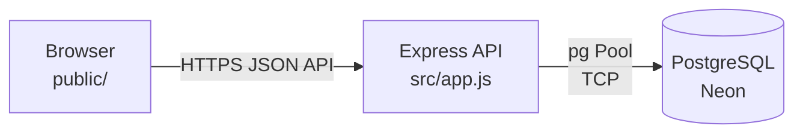

# Todo App

A production-quality ToDo web application with a clean 3-tier architecture:
**Browser (Vanilla JS)** → **Express API** → **PostgreSQL (Neon)**

## Stack

- **Runtime**: Node.js 24.x (ESM)
- **Server**: Express 4.x with layered architecture (routes → service → repository)
- **Database**: PostgreSQL on Neon (serverless, pooled connections)
- **Client**: Framework-free HTML/CSS/ES Modules (served from Vercel CDN)
- **Deploy**: Vercel (zero-config Express detection)
- **Tooling**: ESLint, Prettier, node:test + supertest

## Architecture



## Folder Structure

```
todo-app/
├── db/
│   ├── schema.sql        # DDL for tasks table
│   └── migrate.js        # Idempotent migration runner
├── public/
│   ├── index.html        # Semantic, accessible HTML
│   ├── styles.css        # Responsive, dark/light, a11y
│   └── js/
│       ├── api.js        # Fetch wrapper, timeout, errors
│       └── app.js        # State, rendering, event handlers
├── src/
│   ├── create-app.js     # Express factory (testable)
│   ├── app.js            # Vercel entry (default export)
│   ├── middleware/
│   │   ├── error-handler.js
│   │   ├── logging.js
│   │   └── validation.js
│   ├── routes/
│   │   ├── health.js
│   │   └── tasks.js
│   ├── services/
│   │   └── tasks-service.js
│   └── repositories/
│       └── tasks-repository.js
├── scripts/
│   └── dev.js            # Local dev server (node --watch)
├── test/
│   ├── unit/
│   └── integration/
├── .env.example          # Placeholders only
├── .gitignore
├── package.json
├── vercel.json           # Headers for public/ CSP
├── eslint.config.js
├── prettier.config.js
├── README.md
└── AGENTS.md
```

## Local Setup (5 Commands)

```bash
# 1. Install dependencies
npm ci

# 2. Copy env template and fill in your local DATABASE_URL
cp .env.example .env.local
# Edit .env.local with your local Postgres connection string

# 3. Run database migration
npm run db:migrate

# 4. Start dev server (with file watching)
npm run dev

# 5. Open http://localhost:3000
```

## Environment Variables

| Variable                | Required           | Description                   |
| ----------------------- | ------------------ | ----------------------------- |
| `DATABASE_URL`          | Yes (prod/preview) | Pooled Neon connection string |
| `DATABASE_URL_UNPOOLED` | For migrations     | Unpooled Neon URL             |
| `PORT`                  | Local only         | Default: 3000                 |
| `NODE_ENV`              | Auto               | `development` / `production`  |
| `TEST_DATABASE_URL`     | Optional           | Real DB for integration tests |

## API Reference

### Health Check

```bash
curl https://your-app.vercel.app/api/health
# 200 { "status": "ok" }
```

### List Tasks (newest first)

```bash
curl https://your-app.vercel.app/api/tasks
# 200 { "tasks": [ { "id": "...", "title": "...", "completed": false, "createdAt": "...", "updatedAt": "..." } ] }
```

### Create Task

```bash
curl -X POST https://your-app.vercel.app/api/tasks \
  -H "Content-Type: application/json" \
  -d '{"title": "Buy milk"}'
# 201 { "task": { ... } }
```

### Update Task

```bash
curl -X PATCH https://your-app.vercel.app/api/tasks/<UUID> \
  -H "Content-Type: application/json" \
  -d '{"completed": true}'
# 200 { "task": { ... } }
```

### Delete Task

```bash
curl -X DELETE https://your-app.vercel.app/api/tasks/<UUID>
# 204 No Content
```

## Deployment

1. **Provision Neon**: `vercel integration add neon` (or use dashboard)
2. **Link Vercel project**: `vercel link --yes --project todo-app`
3. **Preview deploy**: `vercel` (smoke test)
4. **Connect GitHub**: `vercel git connect <owner>/todo-app` (or dashboard)
5. **Push to main**: `git push origin main` → auto-deploys to production

## Design Decisions

- **No build step**: Client uses native ES modules, served from Vercel CDN
- **Zero-config Vercel**: Default-exported Express app in `src/app.js`
- **Connection pooling**: `pg` Pool + `@vercel/functions` `attachDatabasePool`
- **Security**: Helmet + strict CSP via `vercel.json` headers; parameterized SQL only
- **Idempotent migration**: Safe to run multiple times

## Known Limitations

- No authentication / multi-user support
- No task categories, due dates, or priorities
- No offline support (Service Worker)
- Single database (no read replicas)

## Troubleshooting

- **Missing DATABASE_URL**: Check Vercel project settings → Environment Variables
- **Empty preview database**: Run `npm run db:migrate` against preview `DATABASE_URL_UNPOOLED`
- **503 on /api/health**: Database connection failed; check logs with `vercel logs`
- **CORS errors**: Not possible — same-origin only; API and UI share domain
